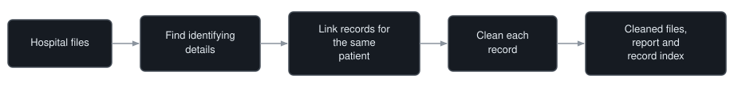

# Secret Wards

Secret Wards helps hospital teams prepare patient records for research. It runs locally, finding and masking personal details such as names and phone numbers in spreadsheets, health records, and clinical notes. When it links two visits to the same patient, researchers can follow that patient's care and measure the time between visits using a substitute ID.

## The problem

A patient's name can appear in a registration table, a discharge note, and a referral attachment. Cleaning just the table leaves the other copies exposed. Removing every date and ID also costs something: researchers can no longer tell whether two visits belong to the same patient or how long a hospital stay lasted.

## Our solution

**Secret Wards links records before it cleans them.** It compares clues across files, including hospital IDs and names written in Hindi or English. When the evidence supports a match, the records receive the same substitute ID.

- A full name found in a table helps the tool find that name again in notes and plain-text attachments. The rules also recognize Hindi labels and Hinglish phrases.
- Linked visits share one date shift. If a patient spent nine days in hospital, the cleaned dates still show a nine-day stay.
- Exact ages become ranges. For rare combinations of age, sex, and location, the tool can widen the age range and hide the district.

## What makes Secret Wards different (USP)

A name found on a registration form can help Secret Wards spot the same name in a discharge note, even when the note has no patient-name field. Across linked visits, a shared substitute ID and a consistent date shift let researchers see how soon a patient returned to hospital.

## Architecture



In the record index, the same patient ID on two lines means the tool linked those records. A `null` ID means the tool could not assign an ID with the available evidence.

## Run in the judging environment

The evaluator runs the commands in `raksha.toml` from the repository root. It creates a Python environment and runs this setup command once:

```sh
pip install -r requirements.txt
```

For each dataset, the evaluator sets `RAKSHA_SECRET` and starts the pipeline offline:

```text
python main.py --input {input} --output {output}
```

The evaluator replaces `{input}` and `{output}` with its own folder paths. The pipeline reads the input folder and writes `sanitized/`, `report.json`, and `records.jsonl` into the output folder.

### Try it locally

With Python 3.10 or newer, run the setup command above. For a practice run on Linux or macOS, use the included sample and a new or empty output folder:

```sh
RAKSHA_SECRET=practice python main.py --input frontend/sample --output demo_output
```

In Windows PowerShell:

```powershell
$env:RAKSHA_SECRET = "practice"
python main.py --input frontend/sample --output demo_output
```

**Local upload interface:** To choose files in a browser and download the cleaned release as a ZIP, run the following commands, then open [the local app](http://127.0.0.1:5058).

```bash
python -m pip install -r frontend/requirements.txt
python frontend/app.py
```

## Measured impact

Pipeline revision `ae16b6f` processed 200 synthetic practice files in 3.75 seconds on the Windows development host. It released 195 files containing 823 records and set aside five. The organizer's checker found zero of 3,230 labeled personal details and zero of four planted identities. It retained 4,732 of 4,855 utility items (97.5%). Patient matching scored precision 1.00, recall 0.86 and F0.5 0.97.

**Hospital stays.** We compared admission and discharge dates in 24 notes with the organizer's known stay lengths. Keeping full shifted dates on those two labeled lines increased exact matches from 15 to 23. The remaining note used dates that could be read as either day-first or month-first. Other date fields in rare records can still show only the month.

**Privacy cost.** We joined released registration and discharge records by patient code. We counted distinct codes sharing a released age band, district field (including a hidden district), shifted admission week and first diagnosis code. Before the change, 14 patients had enough fields for this check and all 14 could be singled out in at least one group. Afterwards, all 20 eligible patients could be singled out. Adding stay length gave the same counts. A patient code alone gives no real name, but this result shows why people with outside knowledge may recognize a record. The official hidden attack score is unknown.

See the [two-page project brief](brief/Project_Brief.pdf) for the design and results.
